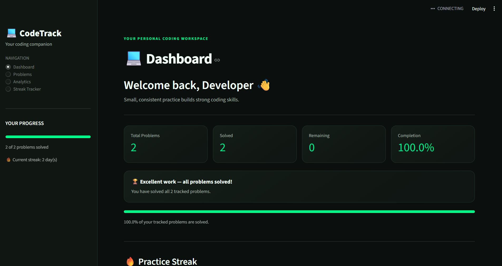

# CodeTrack — Coding Practice Tracker

A Python-based coding practice tracker built with Streamlit to organize coding problems, monitor progress, and visualize practice statistics through an interactive dashboard.
## Dashboard Preview




## Features

- **Dashboard:** View coding practice statistics and overall progress.
- **Problem Management:** Add, search, filter, and delete coding problems.
- **Solved Status:** Track which problems you've completed.
- **Analytics:** Visualize your practice progress with charts.
- **Daily Streak Tracker:** Monitor your coding activity streaks.
- **CSV Export:** Export your problem data for use in spreadsheet applications.
- **Dark Theme:** A custom dark interface with green accents.
- **Data Persistence:** Save problem records locally in a JSON file.

## Tech Stack

- **Python** — application logic
- **Streamlit** — interactive web interface
- **Pandas** — data handling and analytics
- **JSON** — local problem data storage

## Getting Started

### Prerequisites

- Python installed on your computer
- Git (optional, for cloning the repository)

### Installation

1. Clone the repository:

   ```bash
   git clone https://github.com/Bhanutejak09/CODE-TRACKER.git
   ```

2. Open the project directory:

   ```bash
   cd CODE-TRACKER
   ```

3. Install the required packages:

   ```bash
   python -m pip install streamlit pandas
   ```

4. Run the application:

   ```bash
   python -m streamlit run app.py
   ```

5. Open the local URL displayed in your terminal if the browser does not open automatically.

## Project Structure

```text
CODE-TRACKER/
├── app.py
├── problems.json
├── .streamlit/
│   └── config.toml
└── README.md
```

- `app.py` — main Streamlit application
- `problems.json` — locally stored coding problem records
- `.streamlit/config.toml` — Streamlit theme configuration
- `README.md` — project documentation

## Data Storage

CodeTrack stores problem records in `problems.json` in the project directory. Keep this file to preserve your saved data.

## Future Improvements

- Additional progress insights and visualizations
- More flexible filtering and sorting
- Enhanced tracking of coding practice over time

## Author

**Bhanu Teja K**

GitHub: [@Bhanutejak09](https://github.com/Bhanutejak09)

---

*Built to make coding practice easier to organize and track.*

